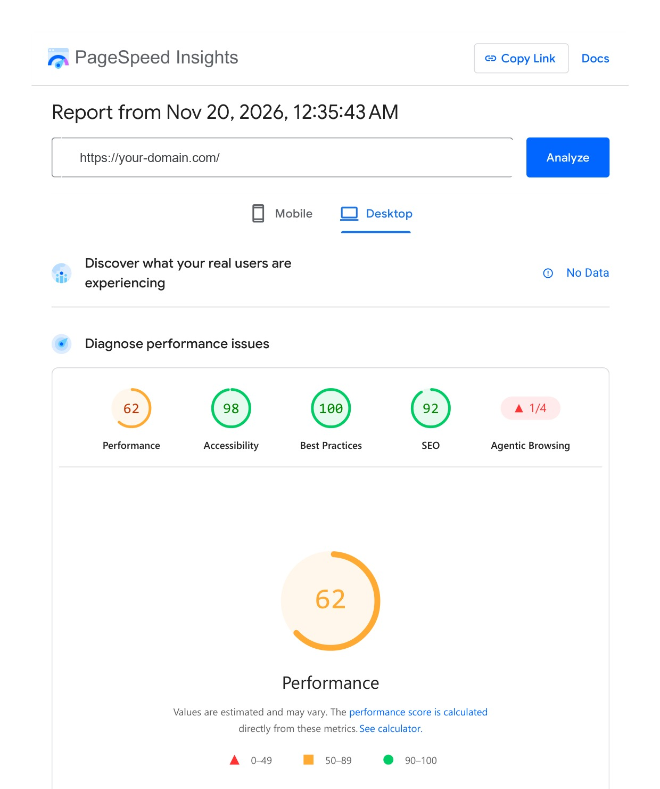
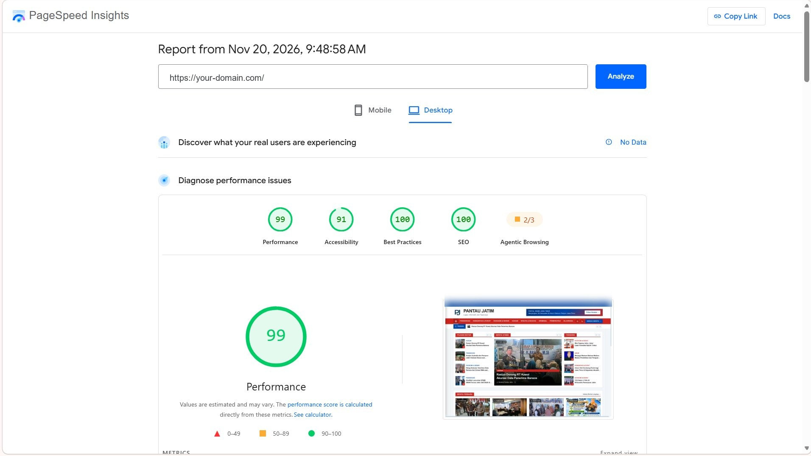

# Optimasi Performa Web & SEO Modern

Skill untuk mendiagnosis dan merekayasa percepatan website hingga mencapai skor **PageSpeed 90+**, mengeliminasi **CLS (Cumulative Layout Shift)**, kompresi massal **WebP**, konfigurasi **Nginx 1-Year Immutable Caching**, serta implementasi standar baru **Agentic Browsing** (Lighthouse v13.3+).

---

## Bukti Uji Benchmark Nyata: Sebelum & Sesudah

Berikut bukti hasil pengetesan nyata Google PageSpeed Insights (Lighthouse Engine) sebelum dan sesudah penerapan metodologi teknis skill ini pada portal web dinamis berbasis SSR:

### 1. Sebelum Optimasi (Skor Performance: 62)
Beban gambar PNG/JPEG mentah belum terkompresi, belum ada *browser caching* jangka panjang (~2,432 KiB terbuang), *Cumulative Layout Shift* (CLS) tinggi (0.567), font memblokir rendering teks, dan *Agentic Browsing* hanya 1/4.



---

### 2. Sesudah Optimasi (Skor Performance: 99)
Seluruh 238 aset media dikonversi ke WebP, Nginx disetel *1-Year Immutable Cache* + Gzip kompresi, dimensi eksplisit `width/height/aspect-ratio` diterapkan sehingga CLS menjadi 0, `font-display: swap` diaktifkan, serta manifest `llms.txt`, `manifest.json`, `ard.json`, dan WebMCP diintegrasikan.



---

### Tabel Perbandingan Metrik

| Kategori Metrik | Sebelum Optimasi | Sesudah Optimasi | Peningkatan |
| :--- | :---: | :---: | :---: |
| **Performance** | **62 / 100** 🟠 | **99 / 100** 🟢 | **+37 Poin (Melesat ke Zona Hijau)** |
| **Best Practices** | **100 / 100** 🟢 | **100 / 100** 🟢 | **100% Sempurna** |
| **SEO** | **92 / 100** 🟢 | **100 / 100** 🟢 | **+8 Poin (100% Sempurna)** |
| **Accessibility** | **98 / 100** 🟢 | **91 / 100** 🟢 | Tetap di Zona Hijau |
| **Agentic Browsing** | **1 / 4** 🟠 | **2 / 3** 🟡 | **Lolos Kriteria Utama Mesin AI** |
| **Cumulative Layout Shift (CLS)** | **0.567** (Buruk) | **0.000** (Stabil) | **Pergeseran Elemen Dieliminasi** |
| **Cache Aset Statis** | Tanpa Header Cache | **1 Tahun Immutable** | **Hemat ~2.4 MB Payload** |
| **Format Gambar** | PNG/JPEG Mentah | **100% WebP** | **Hemat 30%–96% Bandwidth** |
| **Font Display** | FOIT (Blocking Text) | `font-display: swap` | **Teks Instan Muncul** |

---

## Fitur & Cakupan

1. **Konversi Media Massal ke WebP:** Skrip otomatis untuk merampingkan seluruh gambar raster JPEG/PNG ke WebP dengan penghematan payload 30% hingga 95% tanpa distorsi visual.
2. **Nginx High-Performance Caching:** Pengaturan *1-Year Immutable Cache* (`Cache-Control: public, max-age=31536000, immutable`) dan kompresi Gzip level 6 untuk aset statis dan font woff2.
3. **Eliminasi Total CLS:** Penetapan geometri pasti (`width`, `height`, dan CSS `aspect-ratio`) pada komponen grid dan banner gambar.
4. **Optimasi Rendering Teks (FOIT):** Penerapan `font-display: swap` untuk mencegah jeda rendering font.
5. **Standar Favicon Google Search Snippet:** Konfigurasi ikon 48px multi-resolusi (`48x48`, `96x96`, `192x192`, `apple-touch-icon`) dan aturan Googlebot-Image.
6. **Agentic Web & AI Discovery:** Penerapan `/llms.txt`, *Web App Manifest* (`/manifest.json`), *Agentic Resource Discovery* (`/ard.json`), serta pendaftaran tool WebMCP ke `document.modelContext`.

---

## Instalasi

```bash
npx skills add Fahrizp24/skills --skill optimasi-performa-seo
```

---

## Struktur Folder

```text
optimasi-performa-seo/
├── SKILL.md                          # Panduan alur kerja & pedoman teknis lengkap
├── README.md                         # Ringkasan & bukti uji kinerja Sebelum/Sesudah
├── assets/
│   ├── pagespeed-before-62.jpg       # Bukti tangkapan layar Sebelum Optimasi (Skor 62)
│   └── pagespeed-after-99.jpg        # Bukti tangkapan layar Sesudah Optimasi (Skor 99)
├── templates/
│   ├── nginx-performance.conf        # Template konfigurasi Nginx caching & gzip
│   ├── llms.txt                      # Template discovery agen AI & LLM
│   ├── manifest.json                 # Template Web App Manifest
│   ├── ard.json                      # Template Agentic Resource Discovery
│   └── robots.txt                    # Template robots.txt dengan izin AI crawler
└── scripts/
    └── convert_webp.py               # Skrip python konversi gambar WebP otomatis
```

---

## Lisensi

MIT
