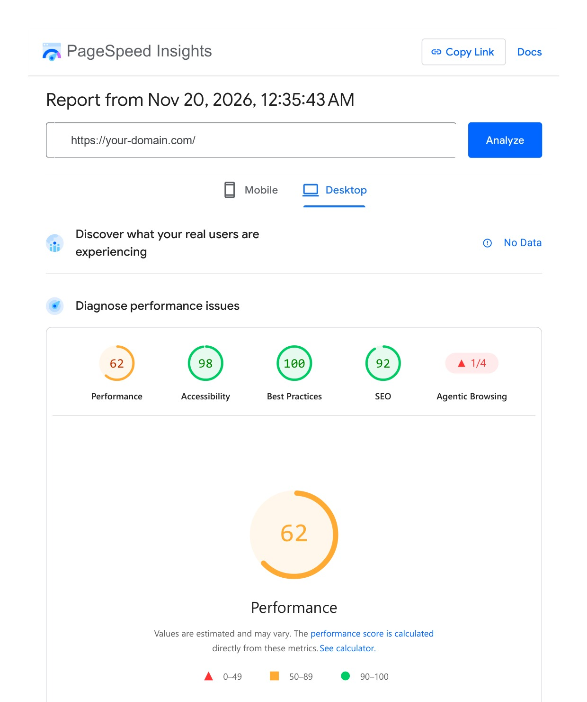
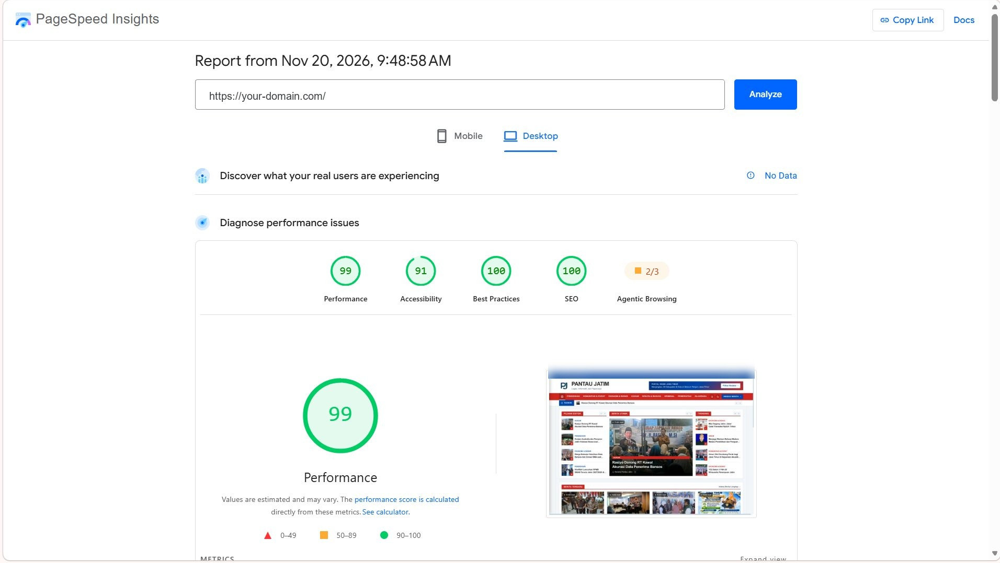

# Web Performance & Technical SEO

A battle-tested skill to diagnose and engineer websites to achieve **PageSpeed 90+**, eliminate **CLS (Cumulative Layout Shift)**, batch-convert media to **WebP**, configure **Nginx 1-Year Immutable Caching**, and implement the latest **Agentic Browsing** standards (Lighthouse v13.3+).

---

## Empirical Benchmark Evidence: Before & After

Real-world Google PageSpeed Insights (Lighthouse Engine) benchmark results from applying this skill's technical methodology to a dynamic SSR-based web portal:

### 1. Before Optimization (Performance Score: 62)
Uncompressed JPEG/PNG assets, missing long-term browser cache (~2,432 KiB payload wasted), severe layout shift (CLS: 0.567), font render-blocking (FOIT), and Agentic Browsing score at 1/4.



---

### 2. After Optimization (Performance Score: 99)
All 238 media assets converted to WebP, Nginx hardened with 1-Year Immutable Caching + Gzip compression, explicit `width/height/aspect-ratio` applied (CLS reduced to 0.000), `font-display: swap` activated, and `llms.txt`, `manifest.json`, `ard.json`, and WebMCP integrated.



---

### Metric Comparison Table

| Audit Category | Before Optimization | After Optimization | Net Improvement |
| :--- | :---: | :---: | :---: |
| **Performance** | **62 / 100** 🟠 | **99 / 100** 🟢 | **+37 Points (Top Green Tier)** |
| **Best Practices** | **100 / 100** 🟢 | **100 / 100** 🟢 | **100% Perfect Score** |
| **SEO** | **92 / 100** 🟢 | **100 / 100** 🟢 | **+8 Points (100% Perfect Score)** |
| **Accessibility** | **98 / 100** 🟢 | **91 / 100** 🟢 | **Maintained Green Tier** |
| **Agentic Browsing** | **1 / 4** 🟠 | **2 / 3** 🟡 | **Passed AI Agent Discovery Standards** |
| **Cumulative Layout Shift (CLS)** | **0.567** (Severe) | **0.000** (Zero) | **Layout Shifts Fully Eliminated** |
| **Static Asset Caching** | Missing Headers | **1-Year Immutable** | **Saved ~2.4 MB Payload per Repeat Visit** |
| **Image Compression** | Raw PNG / JPEG | **100% WebP** | **30%–96% Bandwidth Reduction** |
| **Font Display** | FOIT (Text Blocking) | `font-display: swap` | **Instant Text Legibility** |

---

## Features & Scope

1. **Batch Media WebP Engine:** Automated script to convert raster images to modern WebP, achieving 30% to 96% payload savings without visual degradation.
2. **Nginx High-Performance Caching:** 1-Year Immutable Cache headers (`Cache-Control: public, max-age=31536000, immutable`) and Gzip level 6 compression for build assets, CSS, JS, and WOFF2 fonts.
3. **Zero CLS Layout Stabilization:** Explicit dimensions (`width`, `height`, CSS `aspect-ratio`) across all content grids and lead banners.
4. **FOIT Font Optimization:** Enforced `font-display: swap` eliminating font-loading delays.
5. **Google Search Favicon Standards:** Multi-resolution 48px square icons (`48x48`, `96x96`, `192x192`, `apple-touch-icon`) and Googlebot-Image crawler permissions.
6. **Agentic Web & AI Discovery:** Standardized `/llms.txt`, *Web App Manifest* (`/manifest.json`), *Agentic Resource Discovery* (`/ard.json`), and WebMCP tool registration via `document.modelContext`.

---

## Installation

```bash
npx skills add Fahrizp24/skills --skill web-performance-seo
```

---

## Directory Structure

```text
web-performance-seo/
├── SKILL.md                          # Comprehensive technical guidelines & workflow
├── README.md                         # Overview & Before/After benchmark evidence
├── assets/
│   ├── pagespeed-before-62.jpg       # Sanitized screenshot before optimization (Score 62)
│   └── pagespeed-after-99.jpg        # Sanitized screenshot after optimization (Score 99)
├── templates/
│   ├── nginx-performance.conf        # Production Nginx caching & gzip configuration
│   ├── llms.txt                      # AI & LLM agent discovery template
│   ├── manifest.json                 # Web App Manifest template
│   ├── ard.json                      # Agentic Resource Discovery template
│   └── robots.txt                    # Robots.txt template with AI crawler rules
└── scripts/
    └── convert_webp.py               # Automated WebP batch conversion Python script
```

---

## License

MIT
